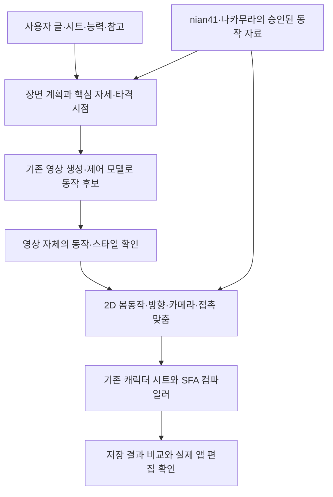

# GPT 검토 — 기존 애니메이션 시스템을 조합하는 방향(2026-11-06)

사용자 질문: “우리의 근본적인 방식이 잘못되고 있던 건 아닌지”, “스파라는 독특한 구조 때문에 다른 시스템들을 가져와 서로 믹스가 되며 시너지를 일으켜 효과적인 진행이 가능한 건 없는지 찾아보는 거 어때?”

**현재 판단: 조합하는 방향을 우선 시험할 가치가 있다. 특히 이미 동작을 생성하도록 학습된 영상 모델과, 편집 구조를 보장하는 우리 컴파일러의 결합을 추천한다.** 다만 SFA가 실패의 단독 원인이라는 증거는 없다. 현재 코드도 중간 표현과 SFA 저장을 분리하고 있다. 바꿀 핵심은 파일 확장자가 아니라 **동작 지식의 공급원·생성 방식·학습 신호·단계별 검증**이다.

상태: 저장소 코드·집계 파일과 외부 공식 저장소·논문을 대조한 조사/제안이다. 외부 모델을 실행하거나 조합의 품질을 실증한 결과가 아니다. 새 GPU 실행·학습·유료 API 호출·자료 추가 수집은 하지 않았다. 최신 확정 조건과 작가별 학습 범위를 변경하지 않는다. 이번 검토 뒤 채택 여부를 정한다.

## 1. 지금까지의 방식에서 무엇이 문제였나

### 확인된 사실

- 현재 `tools/kaggle_stage5_worker.py`는 `Qwen/Qwen2.5-VL-3B-Instruct`에 자체 동작 토큰을 추가하고 LoRA로 학습한다. 이 작업의 배치는 글과 토큰열이며, 원본 동영상이나 시간축 영상 특징을 입력하지 않는다. 영상과 동작 사이의 연결을 이미 학습한 영상 생성기를 사용하는 경로와 다르다.
- `tools/motion_tokens.py`의 키 하나는 23토큰이다. 각도 72칸, 위치 128칸, 길이 16칸으로 나누고 키 사이의 **관절 좌표**를 직선 보간한다. 몸 방향·가시성·스미어는 토큰에 없다. 표현 손실은 기존 경로 시험에서 실제로 관측됐다. 그러나 이것만이 모델 실패의 주원인인지는 미결이다.
- 계획의 스타일 자료 v1은 쉬운 18구간(nian41 14, 나카무라 4), 801장 중 학습 가능 672장이다. 잘라 만든 창과 좌우 반전으로 쌍 수를 늘려도 독립적인 동작 종류가 그만큼 늘지는 않는다.
- 3차 학습의 `stage5_v3_result_2026-11-06.json`은 평가 손실 최고 1.5664를 기록한다. 실제 `train_pairs`는 정지 목표 제외 후 **3,886쌍**이다. 기존 기록의 4,214는 제외 전 분할 규모와 구분해야 한다. 생성 집계는 글 전체 방식 정지 25%, 참고 표시 방식 47.6%다. 낮아진 평가 손실이 좋은 동작을 보장하지 않았다.
- `tools/compose.py`의 실제 조각 검색은 학습한 창작 모델의 대체 기준선이다. 구부정한 뒷걸음을 거꾸로 재생해도 서서 앞으로 걷는 동작의 자료가 새로 생기지는 않는다.
- `tools/retime.py`는 유지 구간의 중간 자세와 골반 위치를 첫 자세로 덮어쓴다. 유지 비율을 맞춘 것과 타격·접지·원래 작화의 움직임을 학습한 것은 다르다.
- 이미 `motion_ir.py`와 `tokens_to_sfa.finalize`가 동작과 파일 생성을 분리한다. “이제 처음으로 중간 표현을 만들자”는 제안은 현재 구현을 놓친 것이다.

근거: [기존 재설계 검토](GPT-MOTION-MODEL-REDESIGN-2026-11-06.md), [계획·실행 기록](REPLAN-PLAN-DRAFT-2026-11-05.md), `data/stage5/stage5_v3_result_2026-11-06.json`, `data/stage6/stage6_gen_v3_result_2026-11-06.json`, 위 코드.

### 그 사실에서 도출하는 판단

1. **언어·그림 이해 모델 위에서 시작했다는 사실만으로, 연속적인 동작을 만드는 사전학습 지식까지 충분히 재사용했다고 볼 수 없다.** 자체 어휘로 글→동작 대응을 새로 배우는 부담이 남았다. 다만 언어 모델에 동작 지식이 전혀 없다는 뜻이나 이 계열이 원리적으로 불가능하다는 뜻은 아니다.
2. 파일을 잘 읽고 저장하는 능력, 한 장 자세의 구조, 동작 내용, 타이밍, 캐릭터 표시를 따로 검증해야 한다. 파일 구조 합격을 액션 품질 합격으로 확대했던 판단은 바꿔야 한다.
3. 검출된 좌표가 정답이 아니고, 생성 영상도 정답이 아니다. 오검출·가림 추론·카메라 효과가 섞인 자료를 더 많이 학습시키기 전에 관측과 추론을 구분해야 한다.
4. 모델들을 연결하는 것 자체에는 이익이 없다. **한 모델이 이미 잘하는 것을 다음 단계가 훼손하지 않고 넘겨받는 경우**에 이익이 생긴다. 연결부가 실패하면 부품을 더 붙일수록 오류가 누적된다.

따라서 지금까지의 작업 전체를 버릴 이유는 없다. SFA 분석·편집망·캐릭터 시트·재현·출처별 자료·사용자 판정은 계속 쓸 수 있다. 반면 현재 3B 자체 동작 토큰 모델을 더 오래 학습하는 것을 다음 기본 선택으로 삼을 근거는 약하다.

## 2. 외부에서 실제로 확인한 결합 방식

아래의 “우리에게 적용”은 제안이다. 원 논문에서 SFA 액션 제작이 검증됐다는 뜻이 아니다.

|후보|공식 자료로 확인한 기능|우리에게 적용할 자리|그대로 채택할 수 없는 부분|
|---|---|---|---|
|**AniSora / Wan 계열 + 우리 2D 동작 맞춤 + SFA 컴파일러**|그림·글로 영상 생성. AniSora V3.2는 Wan2.2 기반 가중치와 임의 장 조건 추론 절차 공개|동작 초안·전환·연출 후보를 만드는 엔진. 먼저 영상 자체를 검토한 뒤 채택한 움직임만 편집망에 맞춤|픽셀 출력이다. 관절 의미·접촉·작가 스타일·SFA 편집망을 보장하지 않는다. 영상→구조 연결은 직접 구현·검증 필요|
|**LiveSVG의 설계 + SFA 제약을 둔 맞춤**|동결한 영상 모델로 목표 영상을 먼저 만든 뒤, 미분 가능한 렌더링으로 원래 SVG 경로를 영상에 맞춤|사전학습 영상의 동작 지식을 벡터로 옮기는 연결 설계. 생성과 벡터 맞춤의 실패를 나눠 볼 수 있음|공식 페이지에서 실행 코드 배포 링크를 확인하지 못함. 자유 경로 변형은 SFA의 점 연결을 보장하지 않음. 원 논문의 설정·자원 수치를 우리 실행 비용으로 쓰면 안 됨|
|**ToonComposer + 핵심 자세·시간표 + 우리 컴파일러**|기준 색 그림과 선택 시점의 스케치·마스크로 사이 장면·채색 영상을 생성. 코드와 가중치 공개|예비 동작·타격·마무리의 시점을 먼저 정하고, 그 사이를 기존 영상 모델이 제안하게 함|글만으로 모든 핵심 자세를 만드는 도구는 아님. 출력은 픽셀. 공식 480p·61장 예시는 약57GB VRAM 요구|
|**AniClipart / GroupSketch + 벡터 부품**|영상 확산 지식으로 벡터 애니메이션 최적화. AniClipart는 키점 궤적·ARAP 변형, GroupSketch는 그룹과 이동 궤적 사용. 코드 공개|이미 있는 벡터를 유지하며 움직이는 기술, 부품별 제어·연결 설계의 비교 후보|고정 그림의 변형은 새 작화를 무한히 그리는 것과 다름. 빠른 타격·스미어·새로 생기는 파편을 해결했다고 볼 수 없음|
|**OmniLottie / LottieGPT**|편집 가능한 벡터 애니메이션 표현·자료. OmniLottie는 실제 추론 코드와 가중치 공개|도형·속성·시간을 묶는 표현, 단순 요소·변환의 참고|액션 몸동작 모델로 입증되지 않음. LottieGPT는 확인한 공식 저장소에 추론 코드·가중치가 배포된 것을 확인하지 못함|

직접 확인한 1차 출처:

- [AniSora 공식 저장소](https://github.com/bilibili/Index-anisora), [V3.2 실행 문서](https://github.com/bilibili/Index-anisora/blob/main/anisoraV3.2/README.md).
- [LiveSVG 저자 페이지](https://levymsn.github.io/LiveSVG/), [논문 본문·한계·구현](https://arxiv.org/html/2605.30174v1), [Google Research 소개](https://research.google/pubs/livesvg-zero-shot-svg-animation-via-video-generation/).
- [ToonComposer 공식 코드·요구 자원](https://github.com/TencentARC/ToonComposer), [저자 페이지](https://lg-li.github.io/project/tooncomposer/).
- [AniClipart 저자 페이지](https://aniclipart.github.io/), [공식 코드](https://github.com/kingnobro/AniClipart), [GroupSketch 공식 코드](https://github.com/Yukinonooo/GroupSketch).
- [OmniLottie 공식 코드](https://github.com/OpenVGLab/OmniLottie), [LottieGPT 공식 저장소·공개 계획](https://github.com/yisuanwang/LottieGPT).

ToonComposer 공식 저장소는 `tooncomposer.com`을 비공식 사이트라고 명시한다. 이번 판단은 그 사이트의 설명에 의존하지 않는다. AniSora도 공식 저장소가 밝힌 출처를 기준으로 확인했다.

### 특히 LiveSVG에서 가져올 것과 경계

좋은 점은 **목표 영상을 먼저 보고 고를 수 있다는 구조**다. 생성 영상이 걷기로 보이지 않으면 SFA 변환에 시간을 쓰기 전에 중단할 수 있다. 반대로 목표 영상은 좋은데 벡터 결과만 나쁘면 연결부 문제로 좁힐 수 있다.

논문은 그룹 변환과 경로의 제어점 변형을 함께 사용하며 DiffVG로 맞춘다. 그러나 목표 영상의 부분 추가·색 변화·큰 가림을 한계로 밝힌다. 고정 방향·기존 요소 유지 같은 생성 조건도 사용한다. 그 설정을 액션 작화의 최종 규칙으로 옮기면 회전과 과장을 제한할 수 있다.

따라서 **LiveSVG 통째 도입**보다 **목표 영상→구조 제약 맞춤이라는 설계의 재사용**이 현재 추천이다. 코드 접근성과 실제 액션 적합성을 검증하기 전에는 완성된 해결책으로 세지 않는다.

## 3. 추천 구성

이는 모델을 동시에 모두 켜는 구성이 아니다. C의 후보 엔진 하나를 골라 시험하고, 나머지 단계는 기존 모듈을 재사용한다. 모델별 Python·CUDA 의존성은 따로 두고 파일 규격으로 연결하는 편이 재현에 유리하다.

### 언어 모델

동작 순서·지속 시간·화면에서의 이동·예비 동작·타격·마무리·부정 조건을 시간표로 정하는 데 쓴다. 좌표 수천 개를 한 토큰씩 예측하는 일을 꼭 맡길 필요는 없다. 시간표가 실제 영상의 순서와 맞는지도 검증해야 한다.

### 동작 엔진

영상과 시간 변화를 이미 학습한 모델을 사용해 어려운 동작 생성의 출발점을 얻는다. 기존 Wan 실험·가중치·승인된 결과가 사용 가능하고 입력 조건에 맞으면 먼저 재사용한다. 가중치가 단순히 존재한다는 이유로 현재 후보와 호환된다고 가정하지 않는다. 기존 LoRA를 다른 기반 모델에 바로 끼우지도 않는다.

완성 인물 그림에 사람이 보이는 경우 RTMW를 초기 관측으로 재사용할 수 있다. 그러나 **좋은 애니 영상→기존 검출기→SFA**만 반복하면 기존의 가림·스미어·사람 바뀜 문제가 그대로 남는다. 처음에는 분리하기 쉬운 단일 인물·명료한 배경으로 연결부의 가능성부터 잰다. 스틱맨 렌더를 영상 모델에 입력했을 때 자연스러운 동작이 나오는지도 별도 미검증 사항이다.

### 2D 동작 맞춤

초기 관측·추적·그림의 실제 윤곽을 함께 보고, 시간 구간 전체에 걸쳐 우리 편집망의 좌표를 맞춘다. 카메라 이동과 몸 상대 움직임을 분리하고, 접촉과 빠른 타격 자세를 보호한다. 투영 길이는 원근에 따라 바뀔 수 있다. 전체를 강하게 평활하거나 몸 길이를 고정해 정지시키는 방법은 피한다.

[CoTracker3](https://github.com/facebookresearch/co-tracker)는 선택한 점의 시간 추적을 보조할 수 있지만 그 점이 팔꿈치인지 판정하는 도구는 아니다. 가림 속 의미적 관절 복원을 보장하지 않는다. [DiffVG](https://github.com/BachiLi/diffvg)는 렌더 결과의 오차에서 경로 좌표를 조정하는 도구이며, 동작 생성기나 SFA 호환 렌더러 자체는 아니다. 둘 다 외부 부품을 넣을 수 있는 자리의 예이며 아직 이 저장소에서 새로 실행하지 않았다.

### 우리 스타일의 학습

최종 목표는 계속 창작 AI다. 조각 복사·통계 보정만을 학습 완료로 부르지 않는다. 기존 사전학습 모델의 기본기를 쓰면서, 우리 자료는 **어떻게 과장하고 언제 멈추며 어떻게 타격을 연결하는지**를 적응시키는 데 집중하는 방향을 제안한다.

작가별 학습 범위는 그대로다. 몸동작 스타일 자료는 nian41·나카무라, 다른 작가의 허용된 이펙트·연출 자료는 해당 갈래에만 쓴다. 참고 모델·참고 자료의 움직임에 유지 비율만 씌우고 “우리 스타일”이라고 하지 않는다. 생성 영상도 자동 정답으로 학습시키지 않으며, 선별·추론 여부·출처와 별도 평가를 남긴다.

### SFA에 맞춰 직접 만들어야 할 부분

- 기본 편집망의 같은 점을 여러 부위가 공유하도록 좌표 변수를 묶는다. 자유 SVG 제어점 각각을 독립 최적화해 연결이 떨어지게 하지 않는다.
- (24,24), 장별 새 점 ID, 대상별 객체 ID, 종류·레이어 일관성을 최종 컴파일에서 보장한다. 내부 키 표현이 최종 앱 트위닝 사용을 뜻하지는 않는다. 다만 빠른 액션의 모든 장을 직선으로 잇는 방식은 고정하지 않는다.
- SVG의 3차 베지어와 SFA의 2차 베지어는 그대로 같지 않다. 선·2차 곡선을 우선 쓰고, 3차가 있으면 허용 오차를 명시해 분할 근사해야 한다. SVG→SFA 무손실 변환을 가정하지 않는다.
- 머리 채움·근경 연속 면·앞뒤 겹침·알파·글로우는 기존 저장 규칙을 재사용한다. 외부 렌더러의 픽셀 일치와 앱 호환은 별도 검사다.
- 배경은 현행 3D 공간/카메라 갈래를 유지한다. 이펙트는 새 모양·생성·소멸이 필요하므로 고정 인물 경로 변형과 별도 갈래로 둔다. 애니 전체를 하나의 고정 SVG로 바꾸려 하지 않는다.

## 4. 현재 조건에서의 우선순위와 비용

1. **먼저 연결부의 정보 손실을 가르는 시험.** 기존에 있는 적합한 영상·SFA로 동작 자체와 변환 후 품질을 분리한다. 새 대규모 모델 학습부터 시작하지 않는다.
2. **그다음 기존 영상 엔진 하나를 활용한 짧은 생성 비교.** AniSora/Wan의 공식 배포·기존 캐시·실행 자원을 확인해 고른다. AniSora 공식 최상위 문서에는 V3.1의 12GB 가용 버전 배포 기록이 있지만, 우리 T4에서의 속도·품질·학습 가능성까지 증명하지는 않는다.
3. **ToonComposer는 제어 방식의 유력한 비교 후보.** 공식 예시 약57GB는 현재 T4 한 장에 들어가지 않는다. T4 두 장의 메모리가 자동으로 합쳐지는 것도 아니다. 저메모리 구현 검증이나 다른 승인된 실행 환경이 필요하다.
4. **SDS 방식·작은 자체 2D 확산·벡터 언어 모델은 비교 또는 후순위.** 좁은 과제에서 장점이 확인되면 채택한다. 지금 모두 학습하면 실패 원인과 비용을 분리하기 어렵다.

외부 논문의 최적화 시간은 우리 비용 추정치가 아니다. 영상 후보 생성·실패·재시도·자료 전송·맞춤·검사를 모두 합쳐 실제 자원 사용을 재야 한다. 현재 GPU 잔여 시간은 새로 확인하지 않았고 과거 사용 기록으로 현재 잔여를 확정하지 않는다.

현행 정본은 [확정 조건](REPLAN-CONDITIONS-2026-11-05.md)이다. 캐릭터 동작에 3D 모델을 쓰는 Kimodo·ARDY·Move-in-2D·MVLift 전체 경로는 이번 기본 추천에서 제외한다. 이름에 2D가 들어가도 출력과 학습 경로가 3D일 수 있다. 이번 조사는 해당 규칙의 변경 허가가 아니다.

## 5. 채택 전에 할 가장 작은 비교

아래는 **아직 실행하지 않은 시험 제안**이다. 현재 진동·가면·걷기 수정 작업은 이 구조 검토 동안 보류 상태이며 완료로 표시하지 않는다.

### 시험 A — SFA 연결부만 검증

- 이미 가진 단순 스틱맨 동작을 영상으로 렌더해 가상 정답으로 삼는다. 원래 좌표를 정답으로 보존하되 맞춤 과정에는 숨긴다.
- 그 영상을 2D 관측/맞춤→현행 컴파일러에 통과시킨다. 관절 의미·연결·시간·카메라·접촉이 얼마나 보존되는지 원래 좌표 및 영상과 비교한다.
- 실제 원본 영상의 새 추출 성능과는 별도 시험이다. 이 시험조차 깨지면 새 영상 생성 모델을 붙이기 전에 연결부를 고친다.

### 시험 B — 실제 액션과 추론 구간

- 기존 nian41·나카무라 중 명료한 이동, 타격과 마무리, 가림이 있는 액션을 분리해 본다. 같은 과거 분석을 반복 집계하지 않고 기존 근거를 재사용한다.
- 기존 추출과 새 맞춤의 차이를 같은 캐릭터·화면·시간으로 보여 준다. 좋은 원본 동작을 변환이 망가뜨리는지 확인한다.
- 한 구간에 맞춘 보정과, 보지 않은 출처에서의 공통 처리를 따로 보고한다. 같은 영상의 겹치는 창을 독립 시험으로 세지 않는다.

### 시험 C — 생성 모델과 결합

- 고정한 “걷기→달리기→펀치”와 타격 중심 짧은 요청에서 기존 compose와 영상 엔진 결합을 비교한다.
- **목표 영상→몸 좌표 표시→레칸 SFA**를 함께 둔다. 목표 영상부터 나쁘면 생성/조건 문제, 좌표에서 나빠지면 관측/맞춤 문제, 시트 적용 뒤 나빠지면 표시/컴파일 문제다.
- 동작 내용·순서·타격 전후·반복 경계·스타일은 사용자 영상 판정을 우선한다. 구조·길이·접촉·좌표 변화량은 보조 근거로 둔다. 가면 원근 개선이 동작 품질 개선으로 섞이지 않게 한다.
- 시도 수와 실패도 전부 기록한다. 잘 나온 영상 하나만 골라 전체 성공처럼 발표하지 않는다. 유지 리듬 통계가 좋아도 걷기로 보이지 않으면 실패다.

GPU 생성·추적·최적화 실행은 기존 지시대로 실행 내용과 예산을 정한 뒤 사용자 허락을 받는다. 이번 조사 요청을 새 GPU 실행 허가로 해석하지 않는다. CPU 검증과 기존 자료 확인은 그 전에 진행할 수 있다.

## 6. 결론과 남는 결정

**추천은 “SFA 전용 AI를 더 크게 학습”에서 “기존 동작 생성 지식 + 우리 스타일 적응 + SFA 구조를 보존하는 연결”로 실험의 중심을 옮기는 것이다.** 현행 중간 표현·캐릭터 시트·컴파일러를 살릴 수 있어 이전 작업과 연결된다.

이 조합이 실제로 더 낫다는 최종 결론은 시험 C의 결과 전에는 내릴 수 없다. 특히 액션의 과장·방향 전환·스미어와 가림, 우리 스타일 학습, 편집 가능한 연결 보존은 남아 있다. 먼저 좋은 움직임을 전달할 수 있는 연결인지 확인하면 새 모델 실패와 SFA 변환 실패를 같은 문제로 취급하는 반복을 줄일 수 있다.

확인한 공식 README 지문: ToonComposer `666d010c871071f596237cc2d8f58db2ca838093`, AniSora V3.2 `434028dfdcf90edf790fa22d5c7bb3c6340ce586`, GroupSketch `abcc185e870317a9aa43875b698e3e7daccef330`. 외부 자료는 2026-11-06 조회 기준이며 실행 성능·가중치 다운로드·SFA 결합은 미검증이다.
